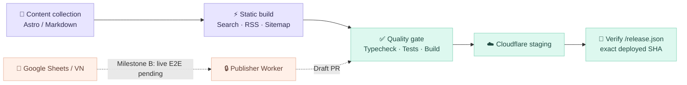

<div align="center">


# TechBlogTip

**Kho tri thức công nghệ tiếng Việt — xây dựng để dễ đọc, dễ biên tập và phát hành có kiểm chứng.**

[](https://astro.build/)
[](https://developers.cloudflare.com/workers/)
[](https://www.typescriptlang.org/)
[](https://nodejs.org/)
[](https://github.com/duykhang68/techblogtip/actions/workflows/quality.yml)

[**Xem staging**](https://techblogtip-staging.tamsudev-com.workers.dev/) · [**Roadmap**](docs/ROADMAP.md) · [**Publication pipeline**](#-publication-pipeline) · [**Chạy local**](#-quick-start) · [**GitHub Actions**](https://github.com/duykhang68/techblogtip/actions)

<sub>⚡ STATIC-FIRST &nbsp; · &nbsp; ✍️ EDITORIAL-FIRST &nbsp; · &nbsp; 🔐 REVIEW-FIRST &nbsp; · &nbsp; ✅ VERIFIED RELEASE</sub>

</div>

---

## ✦ The idea

Một blog kỹ thuật không chỉ cần giao diện đẹp. Nó cần **đường đi rõ ràng từ bản nháp tới bản đã xuất bản**, kiểm tra chất lượng trước khi merge, và bằng chứng rằng đúng commit đã được triển khai.

<table>
  <tr>
    <td width="33%" align="center"><strong>📖 Read beautifully</strong><br/><sub>Giao diện responsive, taxonomy, series, tìm kiếm tĩnh và RSS</sub></td>
    <td width="33%" align="center"><strong>✍️ Write anywhere</strong><br/><sub>GitHub là nguồn xuất bản; tích hợp nguồn biên tập theo roadmap</sub></td>
    <td width="33%" align="center"><strong>🚀 Ship with proof</strong><br/><sub>Draft PR, CI theo exact SHA, Cloudflare và kiểm chứng release</sub></td>
  </tr>
</table>

## ◈ Project at a glance

| Bề mặt | Trạng thái | Nội dung |
| :--- | :--- | :--- |
| 🟢 **Core blog / Milestone A** | **Đã xác minh staging** | Astro, article routes, category/tag/series, static search, RSS, sitemap, responsive UI, CI |
| 🟡 **Sheets Publisher / Milestone B** | **Đang hoàn thiện tích hợp live** | Worker riêng, Google sign-in + allowlist, preview, source fingerprint, Draft PR; E2E ghi thật chưa được công bố là đạt |
| ⚪ **Notion · Obsidian · Drive** | **Theo roadmap** | Editorial adapters và media import, chưa coi là nguồn xuất bản đang hoạt động |
| ⚪ **Knowledge graph · SEO launch** | **Theo roadmap** | Đồ thị tri thức, dashboard, domain production và Search Console |

> **Môi trường hiện tại:** [Cloudflare staging](https://techblogtip-staging.tamsudev-com.workers.dev/) đã được xác minh exact SHA ở Milestone A. Staging vẫn `noindex` và **không đồng nghĩa đã mở public SEO launch**. Theo dõi trạng thái mới tại [Actions](https://github.com/duykhang68/techblogtip/actions) và [ROADMAP.md](docs/ROADMAP.md).

## ⌁ Architecture



**Tách biệt là chủ đích:** trang blog được build tĩnh; Worker Publisher là backend độc lập. Không đưa GitHub API token hoặc Google service-account key vào JavaScript public. Những cạnh nét đứt là tích hợp đang triển khai, **không phải tuyên bố đã phát hành production**.

## ↗ Publication pipeline

```text
  SOURCE              REVIEW & VALIDATION                 RELEASE
  Google Sheet        Draft PR → Exact-SHA CI              main
  (Milestone B)  ──▶  Content checks → Human review  ──▶  Cloudflare
                      FIFO merge gate                       │
                                                        /release.json
                                                            │
                                                       SHA matches?
                                                        ├─ YES → verified
                                                        └─ NO  → blocked
```

**Các bất biến trong pipeline:**

- **Draft-first:** nội dung từ Publisher đi vào Draft PR, không tự động xuất bản.
- **Exact SHA:** kết quả CI phải gắn với commit đang được review; merge chưa đồng nghĩa deploy thành công.
- **FIFO:** duyệt và hợp nhất tuần tự, không vượt hàng đợi.
- **Verify after deploy:** đối chiếu public `/release.json` với SHA triển khai trước khi báo thành công.
- **No client-side GitHub API:** credentials và thao tác ghi ở phía server.

**Google Sheets Publisher** có schema nguồn và Worker riêng tại [docs/PUBLISHER-P5B.md](docs/PUBLISHER-P5B.md), [docs/SHEETS-PUBLISHER.md](docs/SHEETS-PUBLISHER.md). Các bước xác minh tài khoản, cấp quyền và E2E live vẫn là cổng nghiệm thu độc lập.

## ◇ Quick start

Yêu cầu **Node.js ≥ 22.22.0** (khuyến nghị Node 24) và npm.

```bash
git clone https://github.com/duykhang68/techblogtip.git
cd techblogtip
npm install
npm run dev
```

Astro phục vụ local tại `http://localhost:4321` theo cấu hình mặc định.

```bash
npm run quality         # Astro check → content validation → tests → build → verify
npm run qa:visual       # Visual QA khi đã cấu hình browser phù hợp
npm run publisher:test  # Unit/integration tests dạng mock cho Publisher
npm run preview         # Xem output build cục bộ
```

<details>
<summary><strong>🔧 Environment & deployment notes</strong></summary>

- `SITE_URL` xác định canonical/site URL khi build. Chỉ bật `PUBLIC_INDEXABLE=true` sau khi domain công khai và SEO được xác minh.
- Cloudflare staging triển khai từ `main` qua [workflow staging](.github/workflows/deploy-staging.yml). Thiết lập `CLOUDFLARE_API_TOKEN` theo [Operations](docs/OPERATIONS.md).
- Publisher Worker được triển khai **riêng**, theo workflow thủ công [deploy-publisher-dev](.github/workflows/deploy-publisher-dev.yml); cần bindings/secrets độc lập và kiểm tra quyền trước khi bật.
- Không commit OAuth credentials, service-account JSON, GitHub token hoặc secret Cloudflare.

</details>

## ◇ Roadmap / Now → Next

| Phase | Mục tiêu | Tiến độ |
| :--- | :--- | :--- |
| **A · Foundation** | Astro 7, responsive editorial UI, static search, SEO scaffolding, staging proof | ✅ Staging accepted (20/11/2026) |
| **B · Publisher** | Google Sheets workflow, auth, Draft PR, verified writeback; sau đó Notion/Obsidian/Drive | 🟡 In progress |
| **C · Intelligence** | Knowledge graph và editorial dashboard | ◻️ Planned |
| **D · Launch** | Identity, production domain, SEO verification và Search Console | ◻️ Planned |

Chi tiết và acceptance gates được giữ tại **[docs/ROADMAP.md](docs/ROADMAP.md)**; bảng trên là bản tóm tắt, không thay thế kết quả CI hay kiểm chứng triển khai mới nhất.

## ⟡ Repo navigation

| Muốn xem gì? | Đi tới |
| :--- | :--- |
| 🧭 Milestones & acceptance | [Roadmap](docs/ROADMAP.md) |
| 🏗️ Vận hành / deploy / SEO prelaunch | [Operations](docs/OPERATIONS.md) |
| 📚 Frontmatter & content schema | [Content schema](docs/CONTENT-SCHEMA.md) |
| 🔑 Publisher Worker & xác thực | [Publisher P5b](docs/PUBLISHER-P5B.md) |
| 📗 Google Sheets schema & writeback | [Sheets Publisher](docs/SHEETS-PUBLISHER.md) |
| 📐 Visual & accessibility checks | [Visual QA](docs/VISUAL-QA.md) |
| 🛡️ Security & contribution rules | [Security](docs/SECURITY.md) · [AGENTS.md](AGENTS.md) |

## ♥ Engineering principles

**Own the content.** GitHub là nguồn chính thức của nội dung đã review. **Protect the browser.** Không có API secret trong client bundle. **Make change reviewable.** Source/config/workflows qua Draft PR, tránh bypass quality gates. **Ship what was tested.** Kiểm chứng SHA thực tế trước khi gọi một release là thành công.

<div align="center">

---

<sub>Designed for curious minds. Engineered for reliable publishing.</sub>

**[↑ Back to top](#techblogtip)** · [Issues](https://github.com/duykhang68/techblogtip/issues) · [Pull requests](https://github.com/duykhang68/techblogtip/pulls)

</div>
