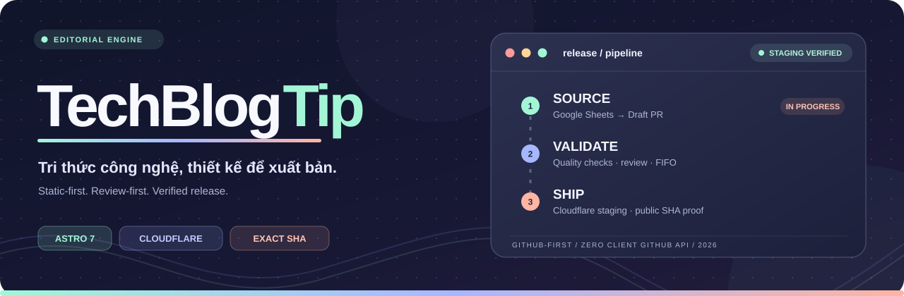

<div align="center">



# TechBlogTip

**Write beautifully. Review carefully. Ship with proof.**

[](https://astro.build/)
[](https://developers.cloudflare.com/workers/)
[](https://www.typescriptlang.org/)
[](https://github.com/duykhang68/techblogtip/actions/workflows/quality.yml)

[**Explore staging**](https://techblogtip-staging.tamsudev-com.workers.dev/) · [**Roadmap**](docs/ROADMAP.md) · [**Actions**](https://github.com/duykhang68/techblogtip/actions) · [**Start locally**](#quick-start)

</div>

---

## Made for curious minds


*Kho kiến thức công nghệ tiếng Việt với giao diện responsive, tìm kiếm tĩnh, danh mục, thẻ, series và RSS. Nội dung được review trước khi phát hành.*

## From draft to verified release


**Foundation:** Cloudflare staging đã được xác minh exact SHA. **Publisher:** tích hợp Google Sheets → Worker → Draft PR đã có nền tảng, nhưng E2E live và production writeback chưa được xác nhận hoàn tất.

[Publisher design](docs/PUBLISHER-P5B.md) · [Sheets contract](docs/SHEETS-PUBLISHER.md) · [Operations](docs/OPERATIONS.md)

## Roadmap


Staging mặc định `noindex`; **chưa phải public SEO launch**. Trạng thái chi tiết và acceptance gates xem tại [ROADMAP.md](docs/ROADMAP.md).

## Quick start

**Node.js ≥ 22.22.0** · khuyến nghị Node 24

```bash
git clone https://github.com/duykhang68/techblogtip.git
cd techblogtip
npm install
npm run dev
```

```bash
npm run quality          # Check · validate · test · build · verify
npm run qa:visual        # Browser visual QA
npm run publisher:test   # Publisher mock integration tests
```

<details>
<summary><strong>Engineering details — architecture, security & deployment</strong></summary>

- **Astro static-first:** pages, search index, RSS and sitemap generated at build time.
- **Draft-first:** source changes are reviewed through PRs; CI must validate the actual HEAD commit. Merge is serialized (FIFO).
- **Deploy with proof:** public `/release.json` must match the deployed SHA. No client-side GitHub API calls.
- **Security:** OAuth tokens, GitHub tokens, service-account JSON and Cloudflare secrets stay on the server. Publisher Worker is independent of public staging.
- **SEO:** set `SITE_URL` correctly; only enable `PUBLIC_INDEXABLE=true` after domain and canonical checks.
- **Future adapters:** Notion, Obsidian and Drive integrations are planned, not claimed live.

[Engineering rules](AGENTS.md) · [Security](docs/SECURITY.md) · [Content schema](docs/CONTENT-SCHEMA.md) · [Visual QA](docs/VISUAL-QA.md)

</details>

---

<div align="center">

**[GitHub Issues](https://github.com/duykhang68/techblogtip/issues)** · **[Pull Requests](https://github.com/duykhang68/techblogtip/pulls)** · **[Documentation](docs/)**

<sub>Iconography: <a href="https://lucide.dev/icons">Lucide Icons</a> · <a href="docs/assets/LUCIDE-LICENSE.txt">ISC license &amp; copyright notice</a>. SVG illustrations are self-hosted; no runtime icon script required.</sub>

</div>
